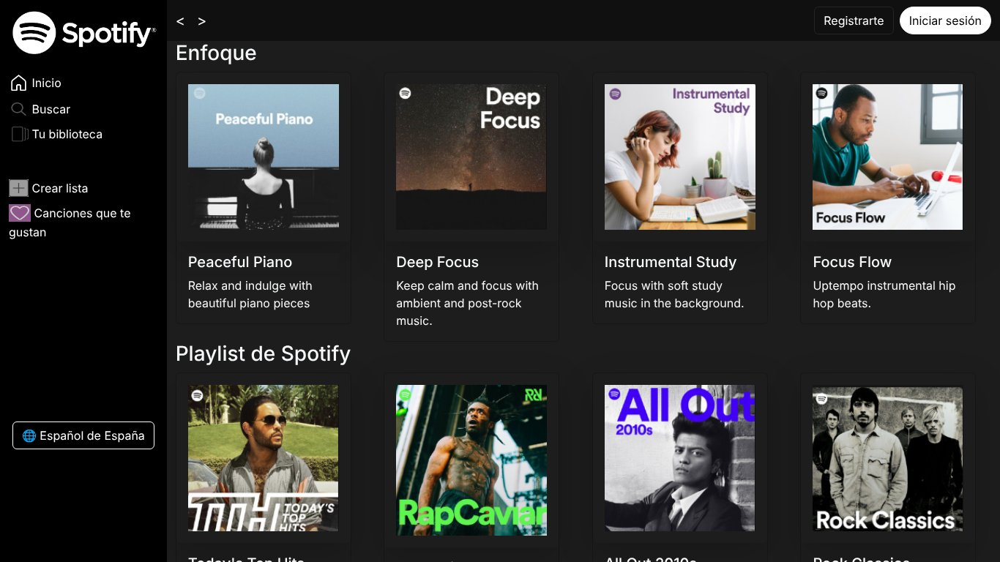
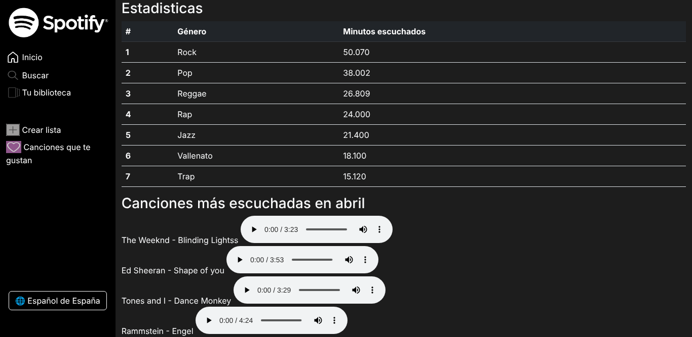
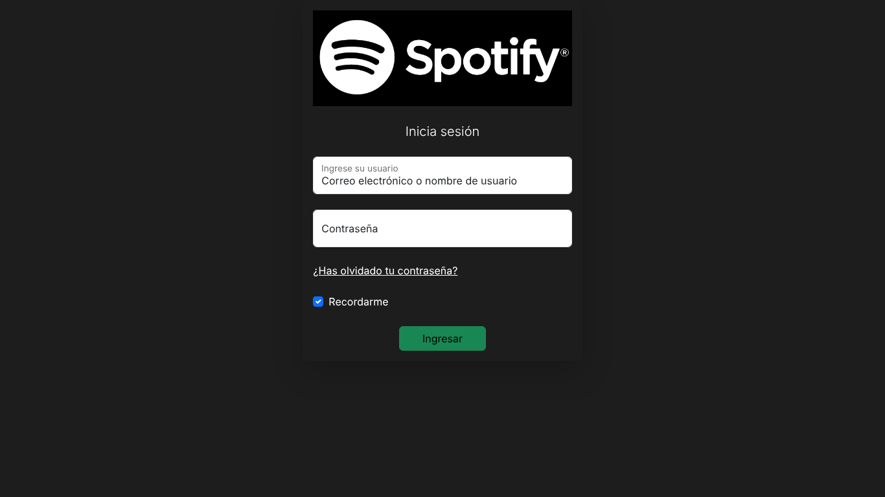

# Spotify UI


[](https://andrestorresaioros.github.io/Spotify/)

Réplica de la interfaz web de Spotify construida con HTML, CSS y Bootstrap como ejercicio de maquetación.

**Demo:** https://andrestorresaioros.github.io/Spotify/

## Vista previa



| Estadísticas y reproductor | Inicio de sesión |
|---|---|
|  |  |

## Pantallas

| Página | Contenido |
|---|---|
| `index.html` | Pantalla principal: menú lateral (Inicio, Buscar, Tu biblioteca, Crear lista) y secciones de playlists en tarjetas. |
| `inicio.html` | Estadísticas del usuario: tabla de minutos escuchados por género y canciones más escuchadas con reproductor de audio. |
| `login.html` | Formulario de inicio de sesión con opción "Recordarme" y recuperación de contraseña. |

## Temas practicados

- Maquetación con flexbox y el sistema de grillas de Bootstrap.
- Menú lateral fijo y navegación entre páginas.
- Tarjetas, tablas y formularios con estilos personalizados.
- Elemento `<audio>` de HTML5.

## Estructura

```
.
├── index.html
├── inicio.html
├── login.html
├── styles/style.css   # Estilos personalizados
└── img/               # Portadas e iconos
```

## Ejecución local

No requiere instalación. Abre `index.html` en el navegador o sirve la carpeta:

```bash
python -m http.server 8000
```

## Aviso

Proyecto educativo sin relación con Spotify AB. La marca, el logotipo y los nombres de playlists pertenecen a sus respectivos propietarios.

## Autor

**César Andrés Torres Bernal** · [GitHub](https://github.com/andrestorresaioros) · [LinkedIn](https://www.linkedin.com/in/andr%C3%A9s-torres10)

## Licencia

El código se distribuye bajo la licencia MIT ([LICENSE](LICENSE)).
